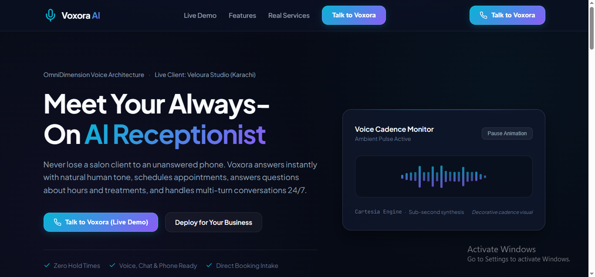
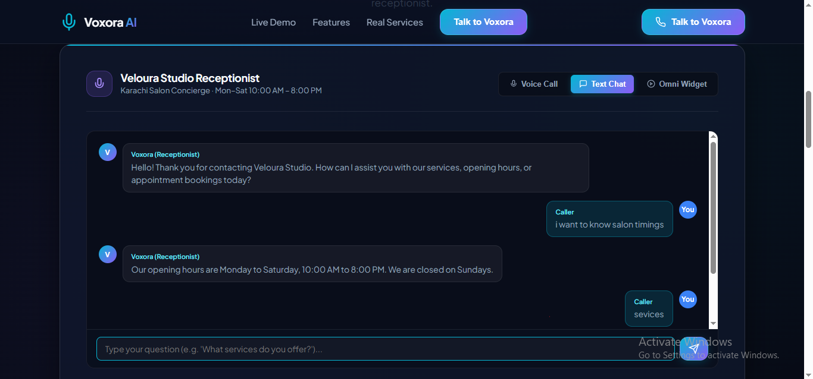
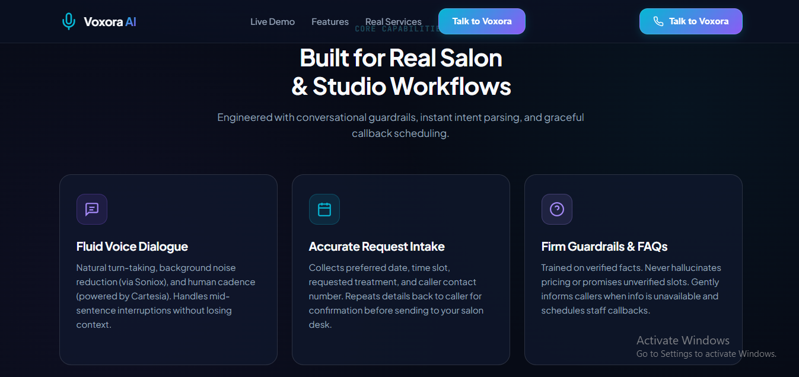
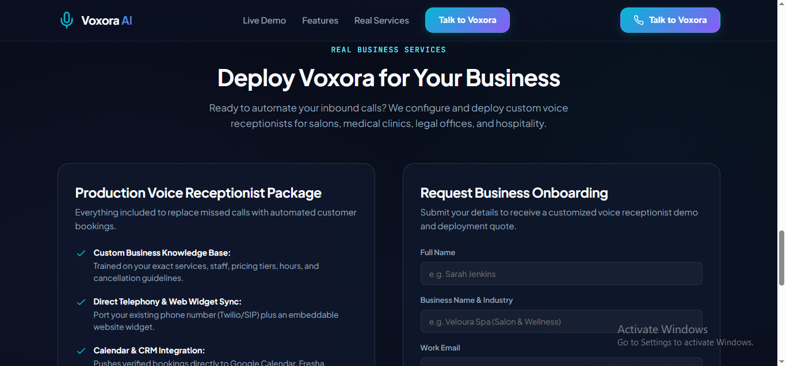

# Voxora AI — Intelligent Voice Receptionist

Voxora AI is a conversational AI receptionist concept designed to help businesses handle customer inquiries, appointment requests, and routine front-desk communication. It features an interactive voice and chat experience with a live demonstration profile for Veloura Studio, a salon in Karachi, Pakistan.

**Live Demo:** https://voxora-ai-voice-agent.vercel.app/

**GitHub Repository:** https://github.com/MahamYasir-ai/voxora-ai-voice-agent

---

## Overview

Missed calls can mean missed appointments and potential customers. Voxora AI explores how conversational voice technology can help businesses provide more accessible customer support without requiring someone to answer every inquiry manually.

The website combines an interactive AI receptionist demo with a presentation of business-oriented voice automation services. The Veloura Studio profile demonstrates how an assistant can answer common questions, collect appointment preferences, and guide callers through a conversation.

## Application Screenshots

### 1. Voxora AI Homepage

Introduces the AI receptionist, its primary benefits, and its conversational voice experience.



### 2. Interactive Voice and Chat Demo

Shows the Veloura Studio receptionist experience, including voice and text interaction options and suggested customer questions.



### 3. Core Capabilities

Highlights natural conversational turn-taking, appointment request intake, and business FAQ handling with defined conversational guardrails.



### 4. Business Deployment Services

Presents the business onboarding section and proposed deployment options for organizations interested in an AI receptionist.



## Key Features

- **Conversational Voice Interface:** An interactive receptionist experience powered by OmniDimension.
- **Voice and Chat Options:** Multiple ways for visitors to explore the demonstration.
- **Appointment Request Intake:** Designed to collect preferred dates, time windows, requested services, and contact details.
- **Business FAQs:** Supports answering questions using configured business information.
- **Conversational Guardrails:** Designed to avoid inventing prices, claiming unverified availability, or promising unsupported bookings.
- **Callback Workflow:** Allows inquiries requiring staff assistance to be directed toward follow-up.
- **Business Onboarding Interface:** A form for businesses interested in a customized receptionist deployment.
- **Responsive Web Experience:** A web interface for presenting and testing the receptionist.

## Live Demonstration: Veloura Studio

Veloura Studio serves as the demonstration business profile for the Voxora AI receptionist.

The demo represents a salon concierge experience in Karachi, with example inquiries about:

- Available salon treatments and services
- Business opening hours and location
- Appointment preferences
- Customer questions that may require staff follow-up

The demonstration illustrates how a business-specific knowledge base and conversational AI can work together to support customer interactions.

## Technology and Services

| Technology or service | Role |
|---|---|
| AI Studio | Application interface development |
| OmniDimension | Conversational agent integration |
| Cartesia | Voice synthesis technology referenced by the application |
| Soniox | Speech-processing technology referenced by the application |
| Vercel | Web application deployment |
| GitHub | Source control and project hosting |

The listed voice services describe the architecture presented by the application. Their availability and actual runtime use depend on the deployed configuration.

## How It Works

1. **Start an interaction:** A visitor chooses an available voice or chat experience.
2. **Understand the inquiry:** The assistant interprets the customer's request and uses the configured business information.
3. **Collect relevant details:** For appointment inquiries, the assistant can request the preferred service, date, time, and contact information.
4. **Apply conversational guardrails:** The assistant should distinguish requested appointment times from verified availability and avoid unsupported claims.
5. **Escalate when necessary:** Questions outside the assistant's configured knowledge can be directed to business staff for follow-up.

Actual booking, calendar synchronization, SMS delivery, and telephone integration require the corresponding services and connections to be configured.

## Business Applications

Voxora AI is designed to be adaptable to different service-based businesses, including:

- Salons and beauty studios
- Physiotherapy and medical reception desks
- Legal offices
- Hospitality and customer service businesses

Each deployment would require business-specific information, conversation rules, and appropriate integrations.

## Business Deployment Offering

The website presents a proposed production receptionist package that can include:

- A custom business knowledge base covering services, pricing, hours, and policies
- Voice-agent integration with a website widget or supported telephony provider
- Calendar or CRM connectivity
- SMS notifications and call summaries

These are proposed deployment capabilities, not a claim that every integration is already active in the public demonstration.

## Live Application

Try the application:

https://voxora-ai-voice-agent.vercel.app/

## Repository

Source code and project updates:

https://github.com/MahamYasir-ai/voxora-ai-voice-agent

Expected screenshot directory:

```text
assets/
└── screenshots/
    ├── voxora-homepage.png
    ├── voxora-live-demo.png
    ├── voxora-features.png
    └── voxora-business-services.png
```

Keep the screenshot paths aligned with the actual files committed to the repository.

## Developer

**Maham Yasir**

Electronics Engineering graduate focused on AI applications, conversational agents, and workflow automation.

GitHub: https://github.com/MahamYasir-ai

---

*Building useful AI applications, automations, and data tools.*
